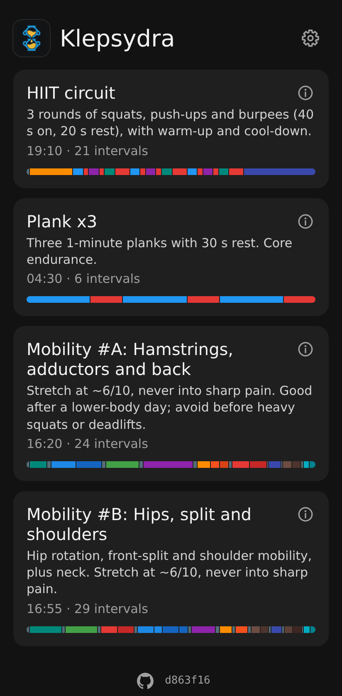
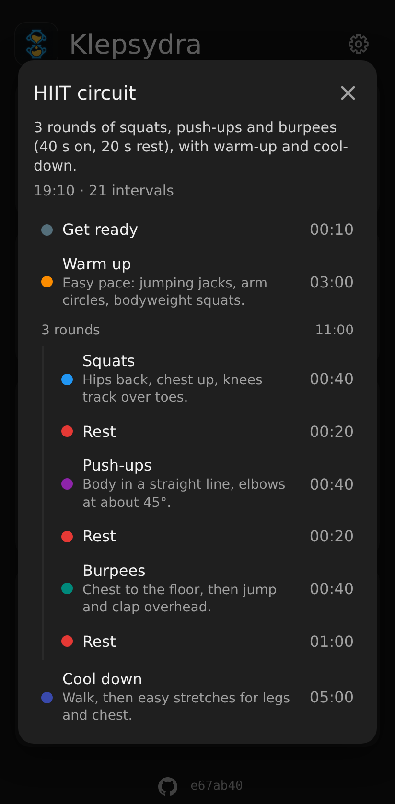
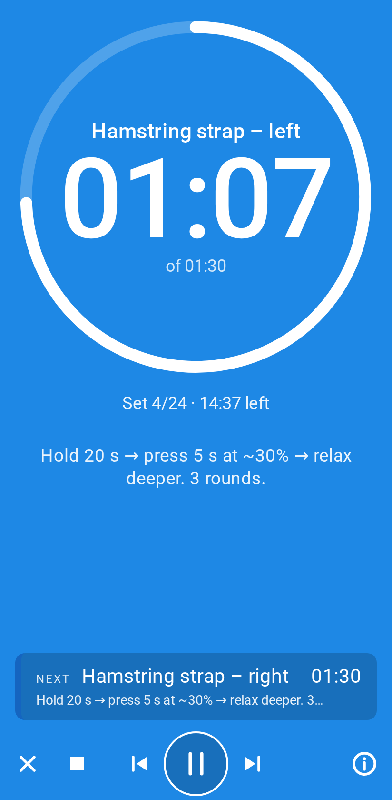
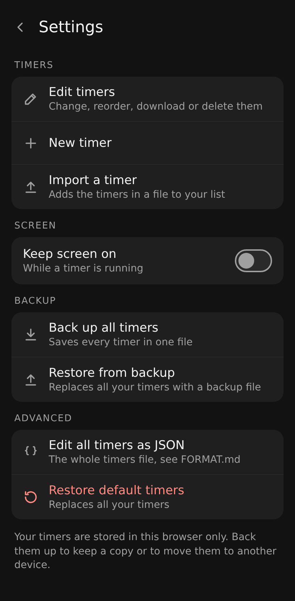
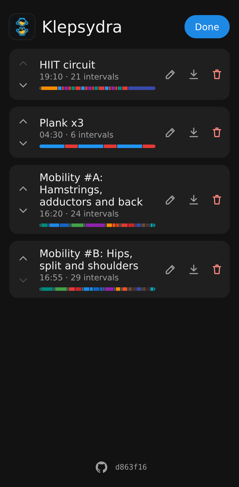
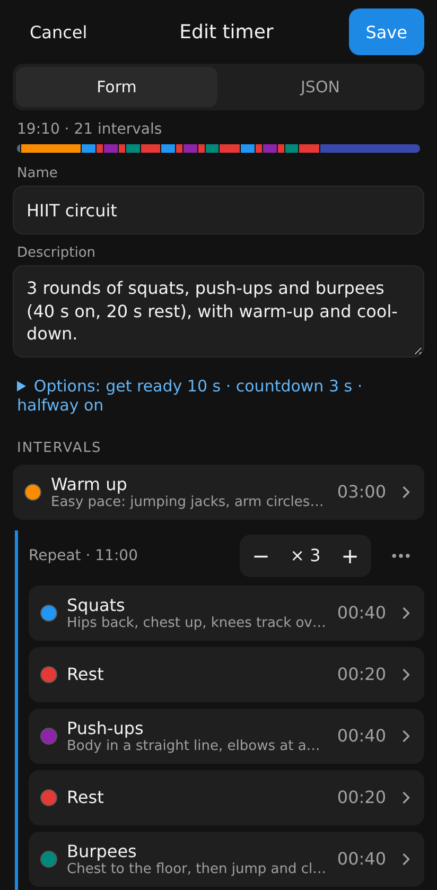
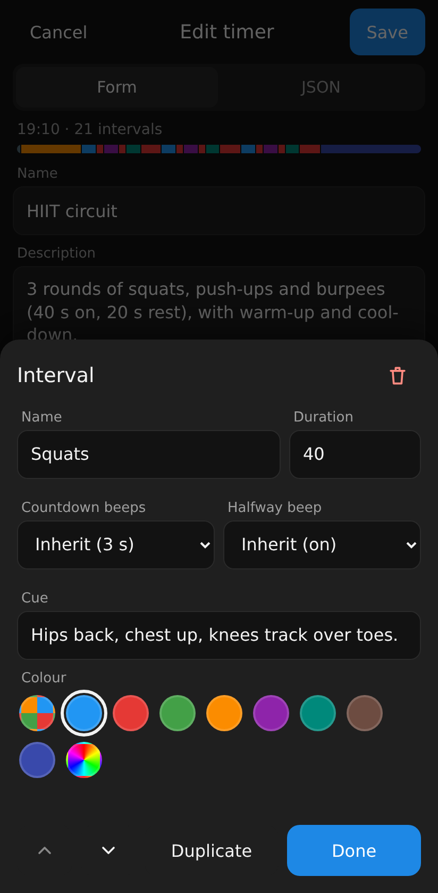

# Klepsydra

An interval timer app. It's a static web app with no build step and no backend, installable on a phone as a PWA and usable offline.

**Try it:** <https://n03l.github.io/klepsydra/>

  
  &nbsp;
  
  &nbsp;
  

## Install on your phone

Open the link above and add Klepsydra to your home screen: on Android (Chrome), open the ⋮ menu and choose **Install app** (or **Add to Home screen**); on iPhone (Safari), tap **Share** and choose **Add to Home Screen**. It then opens full screen like a regular app and works offline.

## Your timers

Until you change anything, the app uses the bundled `timers.json`. Everything for managing timers is under
**⚙ Settings**, the cog at the top right of the list:

  
  &nbsp;
  

| Setting | What it does |
|---|---|
| **Edit timers** | Turns the list into edit mode: ↑↓ reorder, ✎ edit, ⤓ download one timer, 🗑 delete. **Done** goes back. |
| **New timer** | Opens the timer editor with an empty timer. |
| **Import a timer** | Adds the timers in a file (for example one downloaded with ⤓) after yours. Nothing is replaced: a timer whose name is taken gets "(2)" added. |
| **Keep screen on** | Stops the screen from turning off while a timer runs. |
| **Back up all timers** | Saves all your timers in one file. |
| **Restore from backup** | Replaces all your timers with a backup file. |
| **Edit all timers as JSON** | Opens the whole file in a text editor, with **Format** and **Restore default**. |
| **Restore default timers** | Goes back to the bundled timers. |

  
  &nbsp;
  

The timer editor shows the timer's name, description and options, then its intervals. Tap an interval to change
its name, duration (`45` or `1:30`), cue, colour and beeps. **+ Repeat block** adds a group of intervals that runs
several times; set the rounds with − / +, and use ⋯ for the block's own settings. The **JSON** tab shows the same
timer as text (see [FORMAT.md](FORMAT.md)). Nothing is saved until you tap **Save**.

> [!IMPORTANT]
> Saved timers live in this browser's local storage, on this device only. They don't sync between devices, and clearing the site's data (or uninstalling the app) deletes them. Use **Back up all timers** to keep a copy.

### Writing a timer with an AI assistant

For a long routine it can be quicker to let an AI assistant (Gemini, ChatGPT, Claude, …) write it:

1. **Plan the workout.** Ask the assistant for the routine you want, for example: *"A 20-minute hip mobility routine: list each exercise with its duration and a one-line cue, with 10 s to get into position between exercises and each side as its own interval."* Adjust until you like it.
2. **Get the JSON.** Give the assistant [FORMAT.md](FORMAT.md) and ask: *"Following FORMAT.md, write this routine as a timers file with one timer."*
3. **Load it.** Save the answer as a `.json` file and use **⚙ Settings → Import a timer**. Or tap **New timer**, open the **JSON** tab, paste it (just the timer, from `{ "name": …` to its closing `}`) and tap **Save**. If something is wrong, the app shows what and where; paste that message back to the assistant to fix it.

## Controls

Tap a timer in the list to open it.

| Action | Touch | Keyboard |
|---|---|---|
| Play / pause | ▶ / ⏸, or tap the big digits | Space |
| Previous interval | ⏮ | ← |
| Next interval | ⏭ | → |
| Stop and rewind | ■ | |
| Back to the list | ✕, or the phone's back button | Esc |
| Show a routine's details (every interval, with its cue) | ⓘ on a routine in the list, or at the bottom right of the timer | |

## License

The code is licensed under the [GNU Affero General Public License v3.0 or later](LICENSE). If you run a modified version for others to use over a network, you must offer them its source code (the GitHub link at the bottom of the list does this for this repository; point it at yours).

The Klepsydra logo (`logo.jpeg`) and the icons in `icons/` are **not** covered by the AGPL: all rights reserved (see `icons/NOTICE`). If you distribute a modified version, use your own logo.
